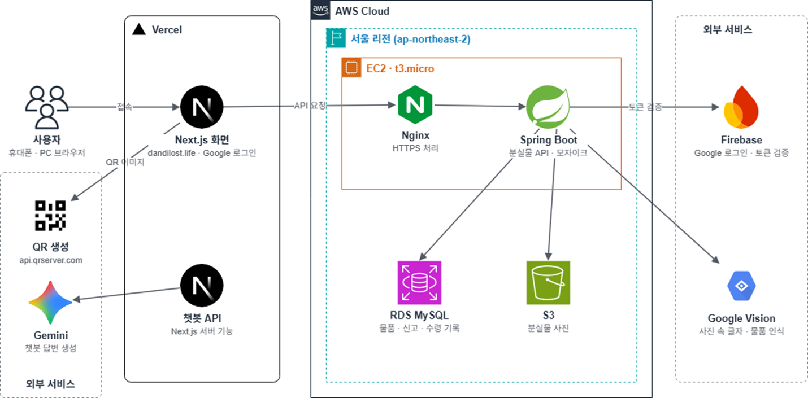

# DANDI Backend

> 단국대학교 교내 분실물 통합 웹 서비스 **단디**의 백엔드. 습득물 신고, 관리자 검수, QR 수령 인증, 이미지 분석을 처리하는 Spring Boot 서버

[](https://github.com/CraneHak/DANDI_lost_and_found_program_management/actions/workflows/deploy.yml)

| 구분 | 링크 |
|------|------|
| 서비스 | https://www.dandilost.life (임시 운영 2026-11-06 ~ 2026-11-20) |
| 프론트엔드 | https://github.com/hprays/DANDI-lost-and-found-program |
| 결과 보고서 · 포스터 · 시연 영상 | (제출 전 링크 추가) |

팀: 이정우(32213459) · 이지학(32213564) · 한산(32214796) — 단국대학교 소프트웨어학과

---

## System Architecture



---

## Tech Stack


-4479A1?style=flat-square&logo=mysql&logoColor=white)


---

## Key Features

### 1. 신고 → 검수 → 공개
- 학생 신고는 `pending`으로 접수하고, 관리자가 사진과 습득 정보를 확인한 뒤 공개 물품으로 연결
- 신고 상태와 물품 상태를 분리해 관리 (`pending → resolved → picked_up` / `ACQUIRED → RECEIVED`)

### 2. QR 수령 인증
- QR 유효시간 10분, 같은 사용자·물품에 유효한 QR이 있으면 기존 QR 반환
- 관리자 인증 시 물품·신고·QR·수령 이력·알림을 **한 트랜잭션**에서 반영 (비관적 행 잠금)

### 3. 이미지 분석과 개인정보 보호
- Google Cloud Vision으로 객체·색상을 추출하고, 신분증·카드 등은 OCR로 민감 영역을 가린 이미지 생성
- 사진 업로드는 형식 검사 후 S3에 무작위 파일명으로 저장

### 4. 인증과 권한
- 학교 Google 계정(Firebase) 로그인, 서버가 ID 토큰과 `@dankook.ac.kr` 도메인 확인
- 일반 사용자 / 관리자 역할 분리, 본인 데이터만 조회

### 5. 개인화
- 관심 물품, 관심 키워드 일치 알림, 서비스 내부 알림, 관리자 작업 이력

### 6. 자동 배포
- `main` 푸시 → 테스트·빌드 → S3 → SSM으로 EC2 교체 → 헬스체크, 실패 시 이전 버전으로 자동 롤백

---

## Trouble Shooting

운영 전 점검과 실제 사용 중에 겪은 문제입니다.

### 1. 포털에서 가져온 물품(144건)은 QR을 발급받을 수 없었음
- **문제**: 학교 포털 분실물 게시판 글 144건을 가져와 넣었는데, 이 물품은 DB 기본 상태가 `STORED`임. QR 발급 조건이 `ACQUIRED`(공개)만 허용해서 목록에는 "수령 가능"으로 보이는데 발급이 거부됨
- **해결**: 목록에서 수령 가능으로 표시되는 `STORED`·`ACQUIRED` 물품에 발급하도록 조건을 맞추고(`ef50fcc`), 수령 완료(`RECEIVED`) 물품은 계속 거부. 같은 날 서버에 배포
- **결과**: 포털 물품과 단디 신고 물품이 같은 절차로 QR을 발급받음 (발급 조건 테스트 `issueAllowsStoredItemVisibleInCatalog`로 확인)

### 2. 관리자 기능에 권한 검사가 없고 사진 원본이 공개 경로에 남음
- **문제**: 로그인만 하면 물품 등록·수정·삭제와 신고 상태 변경을 호출할 수 있었고, 신고 목록은 전체가 보였음. Vision 분석 때 가리기 전 원본이 서버에 저장되어 주소를 알면 접근할 수 있었음
- **해결**: 검수·물품 관리는 관리자만(`hasRole("ADMIN")`), 신고 목록·삭제는 본인 것만 허용(`cccc5c9`). 원본은 저장하지 않고 개인정보를 가린 모자이크만 저장(`77f9460`)
- **결과**: 관리자 계정은 정상 동작하고 관리자 전용 접근은 통합 테스트로 검증됨. 기존 원본 주소는 모두 404

### 3. 다른 기기로 로그인하면 이력과 설정이 사라지고 시간이 9시간 어긋남
- **문제**: 관리자 작업 이력, 수령 코드 목록, "매칭 알림 받기" 설정이 브라우저에만 저장되어 다른 기기에서는 보이지 않았음. 수령 코드는 본인 것만 보였고, 서버 시각이 한국 시간과 9시간 차이로 표시됨
- **해결**: 작업 이력(`admin_action_log` 표)과 알림 설정(`app_user.keyword_alert_enabled`)을 DB에 저장하고 서버 값을 우선 표시. 서버는 UTC로 응답하고 화면에서 한국 시간으로 변환(`39d3da1`). 관리자 수령 코드는 모든 사용자의 것을 표시
- **결과**: 어느 기기에서 로그인해도 같은 이력과 설정이 보이고, 알림 받기를 끄면 키워드 알림이 실제로 생성되지 않음

### 4. 신고 ID와 물품 ID를 같은 값으로 비교해 엉뚱한 항목이 선택됨
- **문제**: 물품 20을 삭제하면 물품 10이 대상이 되는 경우가 있었음. 실제 DB에 "한 물품의 신고 ID가 다른 물품의 ID와 같은" 사례가 16건
- **해결**: 같은 종류의 ID끼리만 비교, QR 응답의 `reportId`는 실제 신고 ID로 수정하고 `lostItemId` 추가
- **결과**: 같은 번호의 신고와 물품이 각각 올바른 화면으로 열림

---

## Getting Started

```bash
git clone https://github.com/CraneHak/DANDI_lost_and_found_program_management.git
cd DANDI_lost_and_found_program_management
cp .env.example .env     # DB, AWS, Firebase, Vision, LLM 값을 채웁니다
./gradlew bootRun        # http://localhost:8080  (상태 확인: /api/public/health)
```

테스트와 빌드: `./gradlew clean test bootJar` (Java 17)
